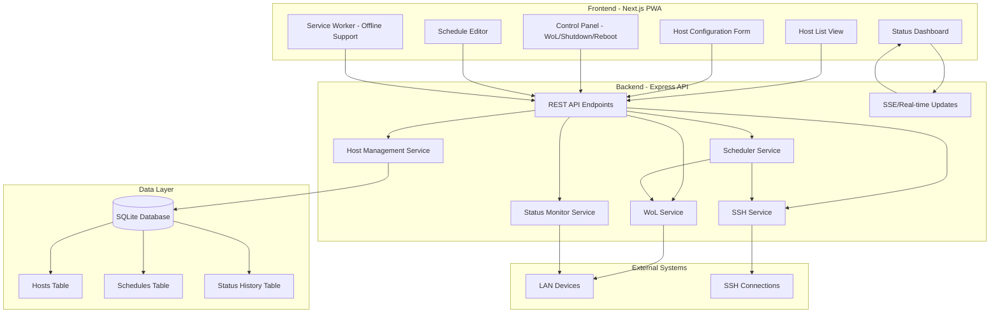

# SelfHost Dashboard - Architecture Plan

## Overview
A Progressive Web App (PWA) dashboard for managing server devices within a LAN. The dashboard allows users to create and configure hosts with IP, MAC, and SSH credentials to perform Wake on LAN, shutdown, reboot, and monitor status with scheduling capabilities.

## Technology Stack

### Frontend
- **Framework**: Next.js 14+ (React)
- **Language**: TypeScript
- **UI Components**: shadcn/ui (Radix UI + Tailwind CSS)
- **State Management**: React Context / Zustand
- **Real-time Updates**: Server-Sent Events (SSE) or polling
- **PWA**: next-pwa plugin

### Backend
- **Runtime**: Node.js
- **Framework**: Express.js
- **Language**: TypeScript
- **Database**: SQLite (better-sqlite3)
- **SSH Client**: node-ssh
- **Network**: dgram (for WoL magic packets), ping (for status checks)
- **Scheduling**: node-cron

## System Architecture



## Database Schema

### Hosts Table
```sql
CREATE TABLE hosts (
    id INTEGER PRIMARY KEY AUTOINCREMENT,
    name TEXT NOT NULL,
    ip_address TEXT NOT NULL,
    mac_address TEXT NOT NULL,
    ssh_username TEXT,
    ssh_password TEXT, -- In production, use encrypted storage
    ssh_port INTEGER DEFAULT 22,
    description TEXT,
    created_at DATETIME DEFAULT CURRENT_TIMESTAMP,
    updated_at DATETIME DEFAULT CURRENT_TIMESTAMP
);
```

### Schedules Table
```sql
CREATE TABLE schedules (
    id INTEGER PRIMARY KEY AUTOINCREMENT,
    host_id INTEGER NOT NULL,
    day_of_week INTEGER NOT NULL, -- 0-6 (Sunday-Saturday)
    power_on_time TEXT, -- HH:MM format
    power_off_time TEXT, -- HH:MM format
    enabled BOOLEAN DEFAULT 1,
    FOREIGN KEY (host_id) REFERENCES hosts(id) ON DELETE CASCADE
);
```

### Status History Table
```sql
CREATE TABLE status_history (
    id INTEGER PRIMARY KEY AUTOINCREMENT,
    host_id INTEGER NOT NULL,
    status TEXT NOT NULL, -- 'online' or 'offline'
    checked_at DATETIME DEFAULT CURRENT_TIMESTAMP,
    FOREIGN KEY (host_id) REFERENCES hosts(id) ON DELETE CASCADE
);
```

## API Endpoints

### Host Management
- `GET /api/hosts` - List all hosts
- `GET /api/hosts/:id` - Get host details
- `POST /api/hosts` - Create new host
- `PUT /api/hosts/:id` - Update host
- `DELETE /api/hosts/:id` - Delete host

### Host Controls
- `POST /api/hosts/:id/wol` - Send Wake on LAN magic packet
- `POST /api/hosts/:id/shutdown` - Shutdown host via SSH
- `POST /api/hosts/:id/reboot` - Reboot host via SSH
- `GET /api/hosts/:id/status` - Get current host status

### Schedules
- `GET /api/hosts/:id/schedules` - Get all schedules for a host
- `POST /api/hosts/:id/schedules` - Create schedule for a host
- `PUT /api/schedules/:id` - Update schedule
- `DELETE /api/schedules/:id` - Delete schedule

### Real-time Updates
- `GET /api/events` - SSE endpoint for real-time status updates

## Component Architecture

### Frontend Components
```
src/
├── app/
│   ├── layout.tsx          # Root layout with PWA meta tags
│   ├── page.tsx            # Dashboard home page
│   ├── hosts/
│   │   ├── page.tsx        # Host list page
│   │   ├── [id]/
│   │   │   ├── page.tsx    # Host detail page
│   │   │   └── schedules/
│   │   │       └── page.tsx # Schedule management page
│   │   └── new/
│   │       └── page.tsx    # Create host page
│   └── api/                # Next.js API routes (if needed)
├── components/
│   ├── ui/                 # shadcn/ui components
│   ├── HostCard.tsx        # Individual host card component
│   ├── HostForm.tsx        # Host creation/edit form
│   ├── ControlPanel.tsx    # WoL, shutdown, reboot controls
│   ├── StatusIndicator.tsx # Online/offline status display
│   ├── ScheduleEditor.tsx  # Timetable editor component
│   └── DashboardLayout.tsx # Main layout wrapper
├── lib/
│   ├── api.ts              # API client functions
│   ├── types.ts            # TypeScript type definitions
│   └── utils.ts            # Utility functions
└── hooks/
    ├── useHosts.ts         # Host data hook
    ├── useHostStatus.ts    # Real-time status hook
    └── useSchedules.ts     # Schedule data hook
```

### Backend Structure
```
backend/
├── src/
│   ├── index.ts            # Express server entry point
│   ├── routes/
│   │   ├── hosts.ts        # Host routes
│   │   ├── schedules.ts    # Schedule routes
│   │   └── events.ts       # SSE event stream
│   ├── services/
│   │   ├── hostService.ts  # Host business logic
│   │   ├── wolService.ts   # Wake on LAN implementation
│   │   ├── sshService.ts   # SSH command execution
│   │   ├── statusService.ts # Status monitoring
│   │   └── schedulerService.ts # Cron job scheduler
│   ├── models/
│   │   ├── database.ts     # SQLite connection
│   │   ├── Host.ts         # Host model
│   │   ├── Schedule.ts     # Schedule model
│   │   └── StatusHistory.ts # Status history model
│   ├── middleware/
│   │   ├── errorHandler.ts # Error handling middleware
│   │   └── cors.ts         # CORS configuration
│   └── types/
│       └── index.ts        # Shared TypeScript types
├── database/
│   └── dashboard.db        # SQLite database file
└── package.json
```

## Key Implementation Details

### Wake on LAN (WoL)
- Use UDP magic packet sent to broadcast address (255.255.255.255)
- Packet format: 6 bytes of 0xFF followed by 16 repetitions of MAC address
- Port: 9 (standard WoL port)

### SSH Commands
- Use `node-ssh` library for SSH connections
- Commands:
  - Shutdown: `sudo shutdown -h now` or `poweroff`
  - Reboot: `sudo reboot` or `systemctl reboot`
- Store credentials securely (consider encryption for production)

### Status Monitoring
- Use `ping` command or ICMP packet to check host availability
- Polling interval: configurable (default 30 seconds)
- Store status history for analytics

### Scheduling
- Use `node-cron` for scheduled tasks
- Check schedules every minute
- Execute WoL at power_on_time
- Execute shutdown at power_off_time
- Handle timezone properly

### PWA Features
- Web App Manifest with icons and theme colors
- Service Worker for offline caching
- Add to Home Screen capability
- Responsive design for mobile devices

## Security Considerations

1. **SSH Credentials**: Store encrypted in database (use environment variables for key)
2. **LAN Only**: No authentication needed, but consider IP whitelist
3. **CORS**: Configure properly for frontend-backend communication
4. **Input Validation**: Validate all user inputs on both frontend and backend
5. **Rate Limiting**: Prevent abuse of WoL and SSH commands

## Development Phases

### Phase 1: Foundation
- Set up Next.js project with TypeScript
- Set up Express backend with TypeScript
- Configure SQLite database
- Create basic API structure

### Phase 2: Core Features
- Implement host CRUD operations
- Implement WoL functionality
- Implement SSH service
- Implement status monitoring

### Phase 3: Scheduling
- Implement schedule data model
- Create schedule API endpoints
- Implement scheduler service
- Build schedule UI

### Phase 4: Frontend UI
- Build host list and detail pages
- Create control panel with buttons
- Implement status dashboard
- Build schedule editor

### Phase 5: PWA & Polish
- Add PWA manifest and service worker
- Implement real-time updates
- Add responsive design
- End-to-end testing

## Environment Variables

```env
# Backend
PORT=3001
DATABASE_PATH=./database/dashboard.db
SSH_ENCRYPTION_KEY=your-secret-key

# Frontend
NEXT_PUBLIC_API_URL=http://localhost:3001
```

## Deployment Considerations

1. Run backend as systemd service for auto-start
2. Use PM2 for process management
3. Configure firewall to allow necessary ports
4. Set up database backups
5. Monitor logs for errors