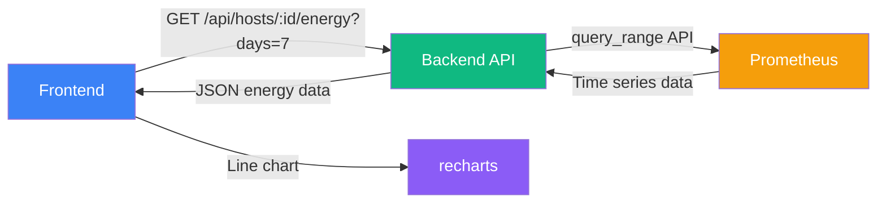
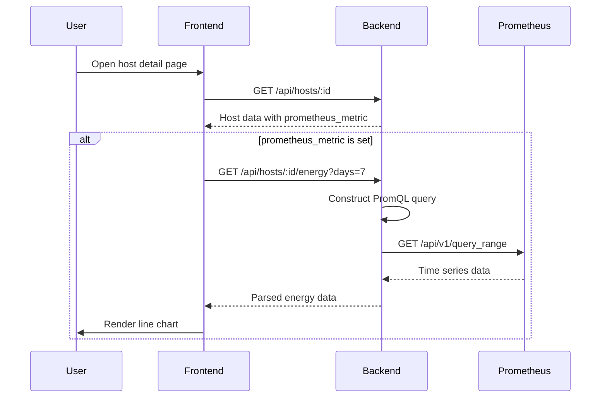

# Prometheus Energy Monitoring Feature Plan

## Overview

Add optional per-host energy consumption monitoring via a remote Prometheus instance. Each host can be configured with a Prometheus metric name. When configured, the host detail page shows a line chart of power consumption (watts) over time.

## Architecture



## Configuration

- **Global**: `PROMETHEUS_URL` in backend `.env` (e.g., `http://192.168.0.100:9090`)
- **Per-host**: `prometheus_metric` column (metric name, e.g., `energy_watts`)
- **Per-host**: `energy_days_range` column (1-15 days, default 7)

## Prometheus Query

The backend constructs a `query_range` request:

```
GET {PROMETHEUS_URL}/api/v1/query_range
  ?query={metric}{instance="{host.ip_address}"}
  &start={now - days}
  &end={now}
  &step={auto-calculated}
```

Step resolution:
| Days | Step |
|------|------|
| 1    | 5m   |
| 2-3  | 15m  |
| 4-7  | 1h   |
| 8-15 | 3h   |

## Implementation Steps

### Phase 1: Backend

#### 1.1 Database migration
**File**: `backend/src/models/database.ts`

Add columns to `hosts` table:
```sql
ALTER TABLE hosts ADD COLUMN prometheus_metric TEXT;
ALTER TABLE hosts ADD COLUMN energy_days_range INTEGER DEFAULT 7;
```

#### 1.2 Update TypeScript types
**File**: `backend/src/types/index.ts`

Add to `Host`, `CreateHostDTO`, `UpdateHostDTO`:
- `prometheus_metric?: string`
- `energy_days_range?: number`

#### 1.3 Update HostService
**File**: `backend/src/services/hostService.ts`

- Add `prometheus_metric` and `energy_days_range` to `createHost` INSERT
- Add to `updateHost` dynamic UPDATE builder

#### 1.4 Create PrometheusService
**File**: `backend/src/services/prometheusService.ts` (new)

```typescript
export class PrometheusService {
  static async queryEnergyMetric(
    metric: string,
    instance: string,
    days: number
  ): Promise<{ timestamp: number; value: number }[]>
}
```

- Uses `PROMETHEUS_URL` from env
- Constructs PromQL: `{metric}{instance="{instance}"}`
- Calls `/api/v1/query_range`
- Parses response into `{ timestamp, value }[]`
- Auto-calculates step based on days
- Verbose logging with `[PROMETHEUS]` prefix

#### 1.5 Add energy API endpoint
**File**: `backend/src/routes/hosts.ts`

```
GET /api/hosts/:id/energy?days=7
```

- Validates host exists and has `prometheus_metric` configured
- Uses `PrometheusService.queryEnergyMetric()`
- Returns `{ host_id, metric, days, data: [{ timestamp, value }] }`

#### 1.6 Environment config
**Files**: `backend/.env.example`, `backend/.env`

Add `PROMETHEUS_URL=http://localhost:9090`

### Phase 2: Frontend

#### 2.1 Install charting library
```bash
cd frontend && npm install recharts
```

#### 2.2 Update TypeScript types
**File**: `frontend/src/types/index.ts`

Add to `Host`, `CreateHostDTO`, `UpdateHostDTO`:
- `prometheus_metric?: string`
- `energy_days_range?: number`

#### 2.3 Add API method
**File**: `frontend/src/lib/api.ts`

```typescript
getEnergyData: async (hostId: number, days?: number) => { ... }
```

#### 2.4 Create EnergyChart component
**File**: `frontend/src/components/EnergyChart.tsx` (new)

- Uses `recharts` `ResponsiveContainer`, `AreaChart`, `Area`, `XAxis`, `YAxis`, `Tooltip`, `CartesianGrid`
- Props: `data`, `days`, `onDaysChange`
- Day range selector (1-15) with buttons or dropdown
- Shows watts on Y-axis, time on X-axis
- Gradient fill under the line
- Loading and error states

#### 2.5 Update host detail page
**File**: `frontend/src/app/hosts/[id]/page.tsx`

- Fetch energy data when `host.prometheus_metric` is set
- Render `EnergyChart` component in a new card below the host info
- Day range selector integrated into the card header

#### 2.6 Update host form
**File**: `frontend/src/app/hosts/new/page.tsx`

- Add new "Energy Monitoring" section with colored icon (green/leaf)
- Fields: Prometheus metric name, Days range (1-15 slider or number input)
- Only shown when Prometheus is relevant (or always visible, optional)

## Data Flow



## Error Handling

- If `PROMETHEUS_URL` is not configured: return 400 with clear message
- If `prometheus_metric` is not set for host: return 404 or skip chart
- If Prometheus is unreachable: return 502 with error message
- If metric returns no data: show "No data available" in chart
- Frontend: graceful fallback - hide chart section if energy monitoring not configured
